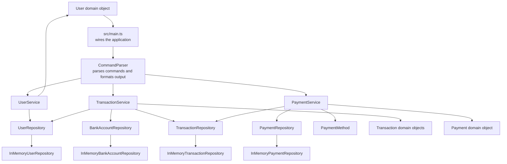
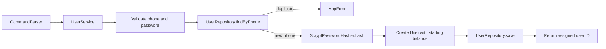
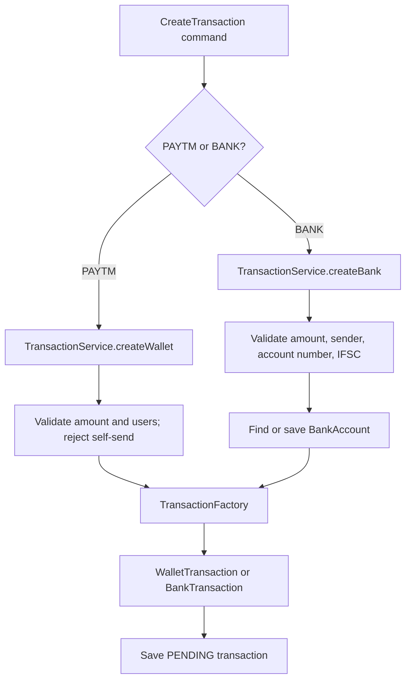
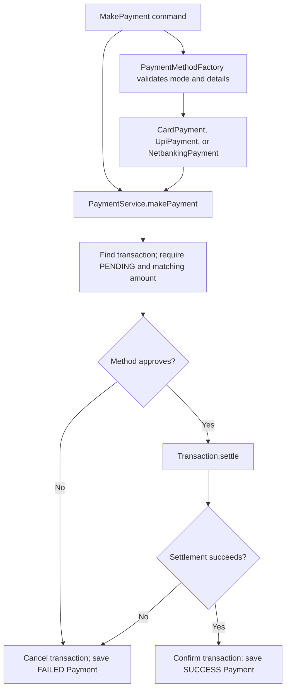
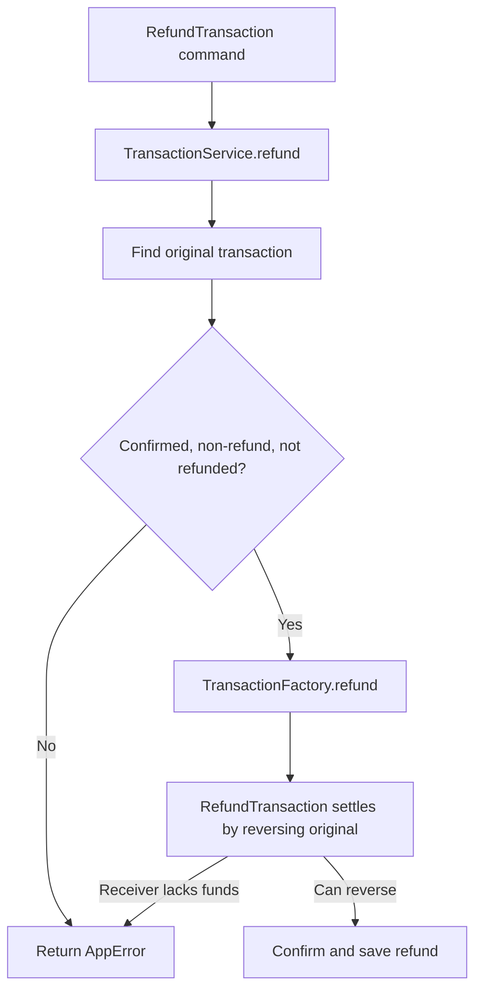

# Payment App LLD

This guide explains the current payment app from the command line down to its domain objects and in-memory storage. The implementation is a small learning project: users, bank accounts, transactions, and payments live in memory for the lifetime of the process.

## Design at a glance



`src/main.ts` is the composition root: it creates repositories, services, and the parser, then reads lines from standard input. `CommandParser` handles the CLI boundary. Services contain the use-case rules, domain objects own money and state behavior, and repository interfaces separate those rules from storage.

## Folder layout

| Folder | Responsibility |
| --- | --- |
| `src/cli` | Parses user commands, validates CLI formatting, and renders results. |
| `src/config` | Shared limits and the initial wallet balance. |
| `src/domain` | User, payment, bank-account, and transaction objects plus enums. |
| `src/errors` | `AppError`, used for expected business and input errors. |
| `src/factories` | Builds the appropriate transaction subtype. |
| `src/payments` | Payment-method interface, implementations, and method factory. |
| `src/repositories` | Storage interfaces and in-memory implementations. |
| `src/services` | Registration, transaction, payment, and refund use cases. |
| `src/utils` | Password hashing and rupee/paise conversion and validation. |

Tests are in `tests/`. `src/main.ts` wires the live CLI; unit tests use `tests/helper.ts` to wire the same application pieces without launching an interactive process.

## Registering and updating a user



`RegisterUser <phone> <password>` requires a 10-digit phone and a password of at least six characters. `UserService` checks for an existing phone, hashes the password, creates a `User` with `STARTING_BALANCE`, and saves it. The in-memory repository assigns an ID and indexes the user by both ID and phone. The password hash uses a random salt and scrypt; `PasswordHasher` also defines verification for callers that need it.

`UpdateUser <user_id> <name> <email>` finds the user, validates the name and email, and updates the profile. The phone number is readonly. `ShowBalance <user_id>` retrieves the user and displays the balance in rupees; stored balances are integer paise.

## Creating a transaction

Creating a transaction records intent only. The transaction starts as `PENDING`; no wallet balance changes until a payment succeeds.



Supported forms:

```text
CreateTransaction PAYTM <from_user_id> <to_user_id> <amount>
CreateTransaction BANK <from_user_id> <account_number> <ifsc> <amount>
```

The CLI amount is in rupees with up to two decimal places. `CommandParser` converts it to paise. `assertValidAmount` requires a positive whole number of paise and enforces `MAX_AMOUNT`. Wallet transfers require two existing, different users. Bank transfers require an existing sender, a 9–18 digit account number, and a valid IFSC; IFSC input is normalized to uppercase. The bank repository reuses an account with the same account number and IFSC.

`TransactionFactory` creates a `WalletTransaction` or `BankTransaction`. The transaction repository assigns an ID and stores it. Its status remains `PENDING` until payment processing.

## Making a payment and settling money



Supported payment forms:

```text
MakePayment <txn_id> CARD <card_no> <MM/YY> <cvv>
MakePayment <txn_id> UPI <upi_id>
MakePayment <txn_id> NETBANKING <bank> <username>
```

The payment-method factory checks the required number of details, then each method validates its own details. This project uses mock provider rules: cards ending in `0000`, UPI IDs beginning with `fail`, and netbanking usernames equal to `fail` are declined. These are examples, not real payment integrations.

`PaymentService` finds the pending transaction and requires the payment amount to equal the transaction amount. If the method declines, the transaction is cancelled and a failed payment record is saved. If the method approves, the service asks the transaction to settle. Settlement checks balances before moving money; insufficient funds also cancels the transaction and records a failed payment. Successful settlement confirms the transaction and stores a successful payment. A confirmed or cancelled transaction cannot be paid again.

For a wallet transaction, settlement debits the sender and credits the receiver. For a bank transaction, it debits the wallet sender. The bank side is represented by a bank account record; no real bank transfer is performed.

## Refunds



`RefundTransaction <txn_id>` only works for a confirmed, non-refund transaction that has not already been refunded. A refund is its own confirmed `RefundTransaction`, linked to the original. It reverses the original movement: wallet refunds debit the original receiver and credit the original sender; bank refunds credit the original sender. If the wallet receiver has already spent too much to cover the refund, reversal fails before balances are changed and no refund record is stored. A refund cannot itself be refunded.

## Transaction history

`ViewTransactionsHistory <user_id>` returns transactions newest first. Wallet transactions and their refunds appear in both parties' histories; bank transactions appear for the wallet sender only. The CLI formats each item from the requesting user's perspective, including sent/received details, masked bank account digits, and whether a wallet refund credits or debits that user. Pending and cancelled transactions also appear because history reports records, not only completed activity. An empty list returns `No transactions`.

## Domain types and state

- `User` stores identity, password hash, profile, creation time, and balance. Its `credit` and `debit` methods enforce valid amounts and sufficient funds.
- `Transaction` holds ID, amount, type, status, and creation time. Only pending transactions can be confirmed or cancelled.
- `WalletTransaction`, `BankTransaction`, and `RefundTransaction` implement participant lookup, settlement, and reversal for their respective flows.
- `Payment` records transaction ID, amount, payment mode, status, and creation time.
- `BankAccount` stores the account number and IFSC associated with a bank transaction.
- `enums.ts` defines transaction types/statuses and payment modes/statuses.
- `AppError` represents expected input and business-rule failures. The parser returns these as readable `Error: ...` messages.

## Repository and runtime boundaries

Services depend on repository interfaces (`UserRepository`, `BankAccountRepository`, `TransactionRepository`, `PaymentRepository`) rather than concrete maps. The current in-memory repositories assign incremental IDs and retain objects only until the process exits. Replacing them with durable database-backed implementations is the intended extension point; persistence, concurrency control, authentication, and real payment/bank integrations are outside the current implementation.

## Verification captured in the pasted terminal output

The reported commands completed successfully:

- `npm test`: 8 test files and 66 tests passed.
- `npm run typecheck`: passed.
- `npm run coverage`: 66 tests passed; 98.15% statements and lines, 93.44% branches, and 100% functions overall.
- Services, domain, config, errors, factories, and utilities reached 100% line coverage in that run. The CLI parser was 94.55%, payments 97.18%, and repositories 97.43%.
- Interface-only files and unused interface methods show 0% because they contain no executable implementation to exercise; several partially covered implementations account for the remaining uncovered lines/branches.

The install output also reported 7 dependency audit findings (3 moderate, 1 high, 3 critical). That output does not identify their packages or impact; inspect `npm audit` separately before deciding whether to change dependency versions.
