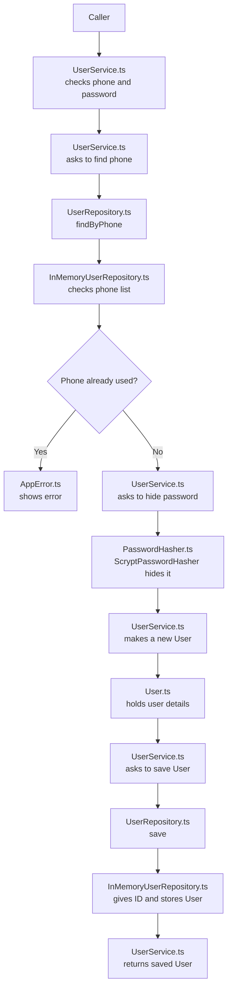
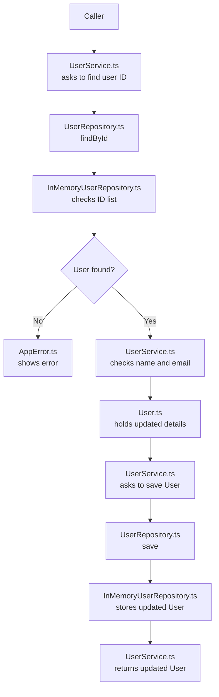

# STEP 1: Users

This page explains how the user code works, one small step at a time.

Think of the app like a little shop:

- `UserService` is the shop worker. It follows the steps for signing someone up.
- `User` is the user's card. It holds their details and balance.
- `InMemoryUserRepository` is the notebook. It remembers users while the app is running.
- `ScryptPasswordHasher` hides the password before it is saved.

## When someone signs up

In everyday words:

1. The caller gives the phone and password to `UserService.ts`.
2. `UserService.ts` checks the phone has 10 numbers and the password has at least 6 characters.
3. `UserService.ts` asks `UserRepository.ts` to find that phone.
4. `InMemoryUserRepository.ts` checks its phone list. If the phone is already there, `AppError.ts` reports a problem.
5. If the phone is new, `UserService.ts` asks `PasswordHasher` in `PasswordHasher.ts` to hide the password. `ScryptPasswordHasher` does the hiding.
6. `UserService.ts` makes a new `User` using the class in `User.ts`. The new user gets the starting balance from `constants.ts`.
7. `UserService.ts` asks `UserRepository.ts` to save the new user.
8. `InMemoryUserRepository.ts` gives the user an ID and remembers the user in its lists.
9. `UserService.ts` gives the saved user back to the caller.

If something is wrong, the app stops and gives an `AppError` message. For example: “Phone number already registered.”

## When someone changes their name or email

The caller gives the ID, name, and email to `UserService.ts`. The service asks `UserRepository.ts` to find the user. `InMemoryUserRepository.ts` looks in its ID list and returns the user, or says it could not find one. The service checks the name and email, changes those fields on the `User` object from `User.ts`, and asks the repository to save it. The service then returns the updated user.

The phone number stays the same because `updateProfile` in `UserService.ts` never asks for a new phone number. Also, `User.phone` in `User.ts` is marked `readonly`, which means the code cannot change it after the user is made.

## What each file does

- [`src/domain/User.ts`](src/domain/User.ts): Holds a user's details and balance. It can add money or take money away safely.
- [`src/services/UserService.ts`](src/services/UserService.ts): Runs the sign-up and profile-change steps.
- [`src/repositories/UserRepository.ts`](src/repositories/UserRepository.ts): Lists the ways the app can save or find a user. `UserService.ts` asks it to do these jobs.
- [`src/repositories/InMemoryUserRepository.ts`](src/repositories/InMemoryUserRepository.ts): Remembers users in two maps while the program is running. It gives new users IDs.
- [`src/utils/PasswordHasher.ts`](src/utils/PasswordHasher.ts): Hides passwords and checks them later.
- [`src/config/constants.ts`](src/config/constants.ts): Says how much starting balance a new user gets.
- [`src/errors/AppError.ts`](src/errors/AppError.ts): The error used when a user does something invalid or cannot be found.

## The simple idea behind the design

`UserService` does not keep the users itself. It asks the repository to do that. The repository is like a helper whose job is remembering users.

The service also does not hide passwords itself. It asks the password helper to do that.

This makes the work easier to follow: one part handles the signup steps, one part remembers users, and one part hides passwords. Later, the notebook could be replaced with a database, while the signup steps stay mostly the same.

## What is not built yet?

This is only STEP 1. The command-line screen, transactions, payments, refunds, and their patterns from `Document.txt` come later.
